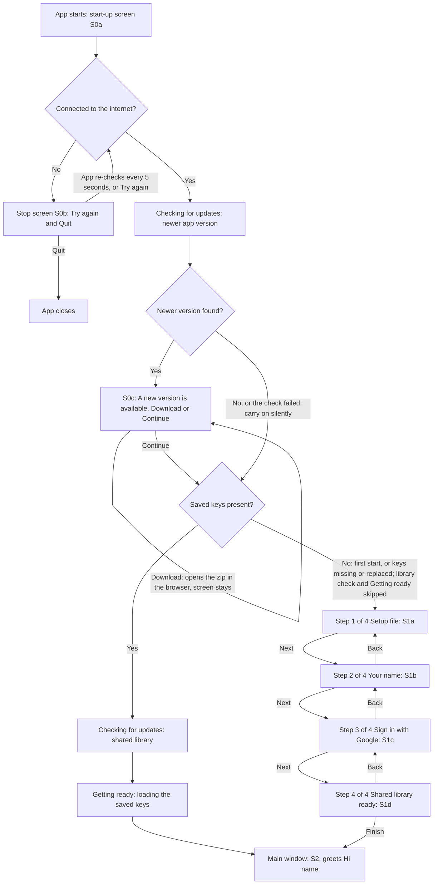
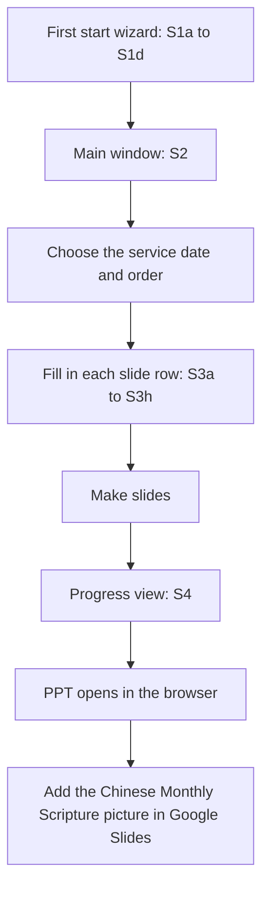
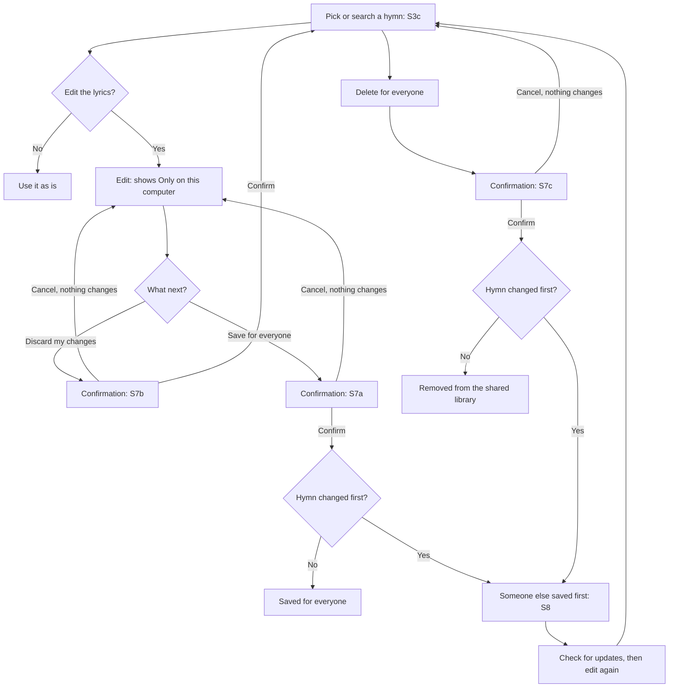
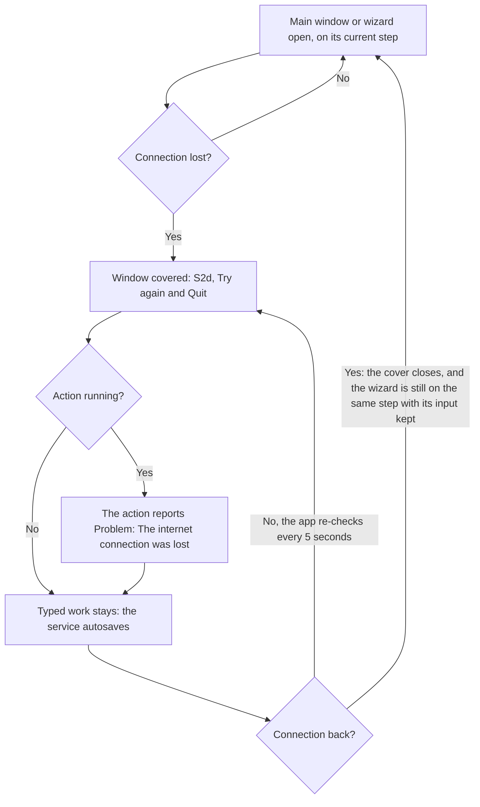

# User Flow: AutoPPT Rewrite

Inputs: `intent-statement.md`, `scope-document.md`, `intent-backlog.md`, `rough-mockups-questions.md` (Q1 to Q9), and `high-level-design.md`. Screen names (S0 to S8) refer to `wireframes.md`. An internet connection is required for the whole app and there is no offline mode (Q7).

## Start-up Flow

Text fallback: every launch opens the start-up screen, which shows the app name, the version and one status line at a time: "Checking your internet connection…", "Checking for updates…", then "Getting ready…" (Q7; design document F0). With no connection the start-up screen stops and shows "You're not connected to the internet. Connect, then choose Try again." with Try again and Quit; nothing else opens, and the app re-checks by itself every 5 seconds (S0b), with a 5-second timeout on each check (Q8). During "Checking for updates…" the app makes one request to GitHub's public latest-release endpoint. If a newer version exists, the start-up screen shows "A new version of AutoPPT is available (x.y.z)" with Download and Continue (S0c); Download opens the zip for this computer in the browser, and the app never downloads or replaces itself. If the check fails, start-up carries on silently (Q8; design document F11). When the saved keys are present, the shared library is refreshed, "Getting ready…" runs and the main window opens. On first start, or when the saved keys are missing or replaced, the library check and "Getting ready…" are skipped (the library loads in wizard step 4), and a four-step wizard runs one step per screen with Back and Next and a "Step n of 4" marker: setup file, your name, sign in with Google, shared library ready. Finish opens the main window (Q6; design document F8).

## Core Flow (happy path)

Text fallback: the first-start wizard (setup file, your name, Google sign-in, library ready) leads to the main window; the operator chooses the date and order, fills in each slide row, presses Make slides, watches the progress view, checks the PPT that opens in the browser, and adds the Chinese Monthly Scripture picture in Google Slides (Q1; design document F1, F2, F8, F12).

The first-start steps happen once. Each later week starts at the main window.

## Hymn Flow

Text fallback: the operator picks a hymn and may edit it; an edit shows "Only on this computer" and can be discarded or saved for everyone. "Save for everyone", "Discard my changes" and "Delete for everyone" each show a confirmation first (S7a, S7b, S7c) that names the hymn and the effect, and Cancel changes nothing (Q6). A confirmed save or delete refused because the hymn changed first shows S8, and the operator checks for updates and edits again (design document F3).

## Make-slides Outcomes

- While a run is going, the row being made shows In progress. Each row ends as Done, Problem, Skipped or To do in Google Slides, and one failed row does not stop the run (design document F2; Q5).
- If "Delete last week's slides" is on, the previous PPT moves to the Trash after the new one is made (design document F2).
- A refused template copy shows "Ask the developer to share the slide template with your Google account and allow copying." (design document F2).

## Connection Lost While the App Is Open

Text fallback: when the connection is lost while the app is open, the window is covered by the same message as the start-up stop screen. Typed work stays because the service autosaves. A running action (making slides, a hymn save) reports Problem with "The internet connection was lost". The app re-checks by itself every 5 seconds, and the cover closes when the connection returns (Q7, Q8; design document F0). The same cover shows over the first-start wizard: the wizard stays on the same step and keeps what was typed (Q8).

## Error Paths

| Situation | What the operator sees | Screen | Source |
|-----------|-----------------------|--------|--------|
| A new version is available | Not an error: the start-up screen shows "A new version of AutoPPT is available (x.y.z)" with Download (opens the zip for this computer in the browser) and Continue; Continue is the default and Escape means Continue | S0c | Q8, Q9 |
| The version check fails or times out | Silent: no message, and start-up carries on after the same 5-second timeout | S0a | Q9 |
| No connection at start-up | "You're not connected to the internet. Connect, then choose Try again." with Try again and Quit; nothing else opens | S0b | Q7 |
| Connection lost while open | The window is covered by the same message; typed work stays; a running action reports Problem "The internet connection was lost"; the cover closes when the connection returns | S2d, S4, S5 | Q7 |
| A row cannot be made | A warning on the row with a plain reason; the rest of the run continues | S2a, S4 | Q3 |
| Runtime problem | Error dialog with a plain summary, Copy details for support and Open log folder | S5 | Q4 |
| A key stops working | A plain message such as "Ask the developer for a new setup file."; a signed-out Google account asks the operator to sign in again | S1, S5 | Q1; design document F9 |
| Hymn changed by someone else | "Someone else saved this hymn first." message | S8 | Q4 |
| New service, no rows | Empty-state hint to choose an order or add slides | S2b | Q3 |
| No hymns yet | Empty-state hint to check for updates or add a hymn | S2c | Q3 |

## Keyboard Flow

Every screen is usable by keyboard alone, and text keeps a contrast ratio of at least 4.5:1 in both themes (Q2, Q5). Screen-reader support is not part of the first version (Q2). The keys named here are proposed, not decided (Q5). Tab moves from the slide list to the settings panel and then to Make slides; Alt+Up and Alt+Down move the selected slide row (design document F1). Escape closes dialogs, except the start-up screens S0b and S0c, which follow their own rules: on S0b Escape does nothing, and on S0c Escape means Continue (Q9). Escape does nothing on the connection-lost cover (S2d), as on S0b.

## Information Architecture

- Window: top bar (Hi name, date, order, New service, Make slides); slide list on the left; settings panel on the right; bottom bar (Check for updates, Settings, signed-in account).
- Screens before the window: start-up screen with its no-connection stop screen and its new-version state (S0a, S0b, S0c), then the first-start wizard (S1a to S1d) when needed.
- Dialogs and covers: make-slides progress, error, settings (with the app version at the bottom), hymn save, discard and delete confirmations, hymn conflict message, and the connection-lost cover (S2d).
- Slide types: Opening Passage, Bible Passage, Chinese Monthly Scripture, Hymn, Announcements, Supplications, Catechism, Spiritual Wisdom, Header and Sermon Header, Next Week's Schedule, Static, Title-only (design document F1).

## Assumptions & Open Questions

None.
