# Components: AutoPPT Rewrite

Inputs: `requirements.md`, `stories.md`, `team-practices.md`, `high-level-design.md` (sections 8 and 9), `refined-mockups/`, and `domain-design-questions.md` (Q1 to Q8). A component is code we write. Google, ESV, the shared library and the operating system are external dependencies, never components. Names say "slide(s)" and never "Ppt" or "Deck" (project rule; Q1). Which Gradle module holds each component is shown in the Module column. How they group into deployable units is decided in Units Generation.

**Module direction (decided at review, ADR-001 and ADR-005).** `core` owns an interface (a port) for everything outside it, listed in the Ports table. The `google`, `esv` and `library` modules implement those ports, so module dependencies run one way only: `app` depends on `google`, `esv` and `library`, and those depend on `core`. `core` depends on none of them. An edge from a `core` component to a component in another module is a call through its port, and its text says so.

```yaml
components:
  - name: Startup
    summary: "Runs the fixed start-up sequence and decides what opens next."
    behaviour: "The sequence is internet check, update check, library refresh, then loading saved keys (FR1.1). On first start, or when keys are missing or replaced, only the version check runs and the library loads in the last wizard step (FR1.4). A library refresh has a 5-second timeout and falls back to the cached copy with a note; with no cache the main window stays closed (FR1.4). The whole sequence is within 10 seconds when every check answers normally (NFR2). It reports the next screen: no connection, new version, wizard, main window, or library not available."
    responsibilities:
      - "The start-up sequence and its timeouts"
      - "Choosing the first screen to open"
    depends_on:
      - component: ConnectionMonitor
        interaction: "Runs the internet check first"
        style: sync
      - component: ReleaseChecker
        interaction: "Checks for a newer app version (through the ReleaseCheckerPort port)"
        style: sync
      - component: LibrarySync
        interaction: "Refreshes the shared library (through the LibrarySyncPort port)"
        style: sync
      - component: SecretStore
        interaction: "Loads the saved keys"
        style: sync
    dependents:
      - component: ScreenViews
        interaction: "Shows the start-up screens"
    entities: []
  - name: ConnectionMonitor
    summary: "Checks the internet and reports when it is lost or back."
    behaviour: "Owns the re-check timing and the events. Asks the ConnectivityProbe port whether the internet works, at start-up and then every 5 seconds while the app is open, and raises lost and restored events (FR1.3, FR1.6). It makes no network request itself: the HTTPS probe is implemented in the google module (HttpsConnectivityProbe). It never queues work: callers decide what stops."
    responsibilities:
      - "Re-check timing and the lost and restored events"
    depends_on:
      - component: HttpsConnectivityProbe
        interaction: "Asks whether the internet works (through the ConnectivityProbe port)"
        style: sync
    dependents:
      - component: Startup
        interaction: "Runs the internet check first"
      - component: ScreenViews
        interaction: "Shows and closes the connection cover"
    entities: []
  - name: SingleInstanceGuard
    summary: "Lets only one copy of the app run on a computer."
    behaviour: "Takes an operating-system file lock that is released when the process ends, so a crash never blocks the next launch (FR3.10). A second launch shows 'AutoPPT is already open' and exits."
    responsibilities:
      - "The one-copy lock"
    depends_on: []
    dependents:
      - component: ScreenViews
        interaction: "Shows the already-open message"
    external_dependencies:
      - name: "Operating-system file lock"
        kind: other
        purpose: "Marks the one running copy"
    entities: []
  - name: ReleaseChecker
    summary: "Finds out whether a newer app version has been published."
    behaviour: "One unauthenticated request to the public latest-release endpoint with a 5-second timeout. Only the latest published release counts; newer means a higher major.minor.patch (FR16.3). A failure, timeout or non-newer release is silent (FR16.5). It never downloads or replaces the app."
    responsibilities:
      - "The update check and version comparison"
    depends_on: []
    dependents:
      - component: Startup
        interaction: "Checks for a newer app version (through the ReleaseCheckerPort port)"
    external_dependencies:
      - name: "Latest-release endpoint of the app repository"
        kind: third-party-api
        purpose: "The newest published version and its zip links"
    entities:
      - name: ReleaseInfo
        identifier: version
        attributes: [version, downloadUrls]
  - name: SecretStore
    summary: "The only owner and writer of secrets.json."
    behaviour: "Holds the Google client ID and secret, the ESV key, the shared-library token and repository name, and the Google refresh token (FR2.5, FR2.7). Writes by temporary file then rename (NFR11). On macOS the file mode is 0600; on Windows the access list is limited to the current user (FR2.5). Sign out removes the refresh token (FR14.2). Tells the Redactor every secret it holds (FR15.4). It never logs or shows a value."
    responsibilities:
      - "secrets.json contents, permissions and atomic write"
      - "Sign out of the Google token"
      - "Telling the Redactor the secrets"
    depends_on:
      - component: Redactor
        interaction: "Gives it every secret to remove from logs"
        style: sync
    dependents:
      - component: Startup
        interaction: "Loads the saved keys"
      - component: GoogleAuth
        interaction: "Reads the client keys and saves the refresh token"
      - component: EsvClient
        interaction: "Reads the ESV key"
      - component: LibrarySync
        interaction: "Reads the library token"
      - component: HymnStore
        interaction: "Reads the library token"
      - component: SetupService
        interaction: "Saves accepted keys"
    external_dependencies:
      - name: "secrets.json in the OS app-data folder"
        kind: other
        purpose: "Owner-only file holding every key and the refresh token"
    entities:
      - name: Secrets
        identifier: secretsFile
        attributes: [googleClientId, googleClientSecret, esvKey, libraryToken, libraryRepository, googleRefreshToken]
  - name: Redactor
    summary: "Removes secrets from anything that reaches a log or support details."
    behaviour: "Runs before any text reaches the log file or the 'Copy details for support' text. Removes authorization header values, the OAuth client secret, refresh and access tokens, the key, token, code and client_secret values, and every value from the setup file (FR15.4). Passage text is never logged."
    responsibilities:
      - "Redacting log lines and support details"
    depends_on: []
    dependents:
      - component: SecretStore
        interaction: "Gives it every secret to remove from logs"
      - component: ErrorModel
        interaction: "Redacts support details"
    entities: []
  - name: ErrorModel
    summary: "Turns failures into plain messages and support details."
    behaviour: "Maps each key failure to one plain message: a rejected ESV key or library token and a disabled Google client say 'Ask the developer for a new setup file.'; an invalid Google sign-in asks to sign in again; a lost connection says 'The internet connection was lost' (FR15.5, FR15.6). Builds the support text (version, OS, Java version, error code, stack trace, affected row) through the Redactor (FR15.3). Keeps the rolling local log (FR15.1). Never uses GitHub, repo, commit, API or token wording (FR15.7)."
    responsibilities:
      - "Error messages and error codes"
      - "Support details text"
      - "The local rolling log"
    depends_on:
      - component: Redactor
        interaction: "Redacts support details"
        style: sync
    dependents:
      - component: MakeSlidesRun
        interaction: "Turns a failure into a plain message"
      - component: ScreenViews
        interaction: "Shows errors"
    external_dependencies:
      - name: "Rolling log file in the OS app-data folder"
        kind: other
        purpose: "Local log, never sent anywhere"
    entities:
      - name: ErrorReport
        identifier: errorCode
        attributes: [errorCode, userMessage, whatToTry, supportDetails, affectedRow]
  - name: GoogleAuth
    summary: "Signs the user in with Google and supplies authorised access."
    behaviour: "Opens the system browser and receives the sign-in on a loopback address (FR2.7). Saves the refresh token through SecretStore. A client Google rejects shows 'This setup file doesn't work with Google sign-in. Ask the developer for a new setup file.' (FR2.7). A sign-in that is no longer valid asks the user to sign in again (FR15.5). Sign out is done here: it removes the refresh token by calling SecretStore (FR14.2)."
    responsibilities:
      - "Google sign-in and token refresh"
      - "Sign out of Google"
    depends_on:
      - component: SecretStore
        interaction: "Reads the client keys and saves the refresh token"
        style: sync
    dependents:
      - component: TemplateReader
        interaction: "Gets authorised access"
      - component: SlideWriter
        interaction: "Gets authorised access"
      - component: SlidesCleaner
        interaction: "Gets authorised access"
      - component: ScreenViews
        interaction: "Sign in with Google and sign out"
    external_dependencies:
      - name: "Google OAuth"
        kind: third-party-api
        purpose: "Sign-in and access tokens"
    entities: []
  - name: EsvClient
    summary: "Fetches Bible passages from the ESV service."
    behaviour: "Sends the reference as typed to the passage text endpoint and uses the canonical reference it returns (FR5.3). Requests: headings, footnotes, passage references, short copyright and Selahs off, verse numbers on (FR5.4). Respects 500 verses per query, 5,000 a day, 1,000 an hour and 60 a minute (FR5.11). Keeps passage text in memory for the session only. A reference it cannot find is reported as a plain row error (FR5.10)."
    responsibilities:
      - "ESV requests and limits"
      - "The session passage cache"
    depends_on:
      - component: SecretStore
        interaction: "Reads the ESV key"
        style: sync
    dependents:
      - component: SetupService
        interaction: "Checks the ESV key (through the BibleSource port)"
      - component: PassageLayout
        interaction: "Gets the passage text (through the BibleSource port)"
    external_dependencies:
      - name: "ESV API"
        kind: third-party-api
        purpose: "Passage text and canonical references"
    entities:
      - name: Passage
        identifier: canonicalReference
        attributes: [reference, canonicalReference, verses]
  - name: LibrarySync
    summary: "Reads the shared hymn library into a local cache and keeps it fresh."
    behaviour: "Lists the shared library, downloads only files whose version number (SHA) changed, and keeps the cache with each file's SHA (FR7.8). Refresh runs on start (not on first start) and on Check for updates, within 5 seconds for changed files (NFR3). A hymn file is read as UTF-8 and tolerates a byte-order mark and CRLF; a malformed file is skipped and reported (FR7.10). Files newer than the app understands are refused with an update message (FR7.9). For Reload all hymns it offers two steps to ReloadAllHymns: download every hymn into a temporary copy, and swap that copy in as the cache. It never decides to swap on its own (FR14.5). It never writes to the shared library. A newer shared version of a locally edited hymn is reported so the badge can show (FR7.8)."
    responsibilities:
      - "The local library cache and SHAs"
      - "Refresh, first download, and the download and swap steps of Reload all hymns"
      - "Skipping malformed hymn files"
    depends_on:
      - component: SecretStore
        interaction: "Reads the library token"
        style: sync
    dependents:
      - component: Startup
        interaction: "Refreshes the shared library (through the LibrarySyncPort port)"
      - component: HymnStore
        interaction: "Reads the cached SHA and updates the cache after a write"
      - component: Configuration
        interaction: "Reads the configuration files from the cache (through the LibrarySyncPort port)"
      - component: ServiceBuilder
        interaction: "Points hymn rows at shared hymns (through the LibrarySyncPort port)"
      - component: SetupService
        interaction: "Checks the library token and loads the library (through the LibrarySyncPort port)"
      - component: ScreenViews
        interaction: "Check for updates"
      - component: SlideEditors
        interaction: "Lists the shared hymns"
      - component: ReloadAllHymns
        interaction: "Downloads every hymn into a temporary copy, then swaps the cache (through the LibrarySyncPort port)"
    external_dependencies:
      - name: "Shared library repository (contents listing and file downloads)"
        kind: third-party-api
        purpose: "Hymn and configuration files"
      - name: "Library cache folder"
        kind: other
        purpose: "Local copy for fast start-up"
    entities:
      - name: Hymn
        identifier: hymnId
        attributes: [hymnId, title, language, aliases, arrangement, blocks, updated, updatedBy, sha]
      - name: LibraryFile
        identifier: path
        attributes: [path, sha, schemaVersion]
  - name: HymnStore
    summary: "Saves, adds and deletes hymns in the shared library with the first-save-wins rule."
    behaviour: "Save and delete send the last-known SHA, so a stale change is refused (FR7.3, FR7.7). A new hymn whose id already exists is refused (FR7.4, FR7.6). Both refusals give the same plain message and the typed text stays in the service row (FR7.4). The id is a lowercase ASCII slug of the title, with a number added on a clash, checked case-insensitively, and 'hymn-' plus a short random id when no usable letters (FR7.6). The save message names the hymn and the typed user name (FR7.3). It never keeps local edits."
    responsibilities:
      - "Write, add and delete with the SHA check"
      - "Hymn id generation"
      - "Conflict result"
    depends_on:
      - component: LibrarySync
        interaction: "Reads the cached SHA and updates the cache after a write"
        style: sync
      - component: SecretStore
        interaction: "Reads the library token"
        style: sync
    dependents:
      - component: HymnMigrator
        interaction: "Adds the converted hymns"
      - component: SlideEditors
        interaction: "Save, add and delete hymns"
    external_dependencies:
      - name: "Shared library repository (file write and delete)"
        kind: third-party-api
        purpose: "Hymn files"
    entities: []
  - name: HymnMigrator
    summary: "One-time developer tool that converts the legacy hymn database."
    behaviour: "Converts the 116 hymns of the legacy HymnDatabase.db to one file each (id, title, language, aliases, optional arrangement, update fields, blocks) (FR8.1). A hymn that cannot be converted is listed and does not stop the others (FR8.2)."
    responsibilities:
      - "Legacy hymn conversion"
    depends_on:
      - component: HymnStore
        interaction: "Adds the converted hymns"
        style: sync
    dependents: []
    external_dependencies:
      - name: "Legacy HymnDatabase.db"
        kind: database
        purpose: "Source of the 116 hymns"
    entities: []
  - name: Configuration
    summary: "Holds the slide types, presets, layout values and font map."
    behaviour: "Reads app, slide-types, presets, layout and fonts files from the library cache (FR13.3). Slide types and the template id are read-only in the app and new types cannot be created (FR13.3). Refuses configuration files newer than it understands and reads older ones (FR7.9, NFR12). Lists templates with a language for later (FR13.6). Builds the Add slide list from the slide types (FR3.5)."
    responsibilities:
      - "Slide types, presets, layout values and font map"
      - "Schema version checks"
    depends_on:
      - component: LibrarySync
        interaction: "Reads the configuration files from the cache (through the LibrarySyncPort port)"
        style: sync
    dependents:
      - component: TemplateChecker
        interaction: "Reads the slide types and fonts"
      - component: ServiceBuilder
        interaction: "Gets slide types and presets"
      - component: Paginator
        interaction: "Reads layout values and the font map"
      - component: PassageLayout
        interaction: "Reads layout values"
      - component: HymnLayout
        interaction: "Reads layout values"
      - component: MakeSlidesRun
        interaction: "Gets the template id and passes it in the slide plan"
      - component: SlideEditors
        interaction: "Gets the editor kind for a slide type"
    entities:
      - name: SlideType
        identifier: tag
        attributes: [tag, layoutKind, editor, defaultTitle]
      - name: Preset
        identifier: presetName
        attributes: [presetName, defaultRows]
        references:
          - entity: SlideType
            owned_by: Configuration
            relationship: "each default row names one slide type"
      - name: LayoutSettings
        identifier: layoutKey
        attributes: [verseGap, safetyMargin, emptyRoleText, sourceIndent]
      - name: FontMap
        identifier: templateFont
        attributes: [templateFont, measurementFont]
  - name: TemplateReader
    summary: "Reads the Google Slides template: tags, placeholders, fonts and roles."
    behaviour: "Finds template slides by the tag in their speaker notes (FR13.1). Reports the placeholders and fonts in each slide and the schedule roles from the left-column text (FR10.1, FR13.2). Checks it can read the template before the first run; a 403 or 404 gives the share-the-template message (FR12.6)."
    responsibilities:
      - "Reading template tags, placeholders, fonts and roles"
      - "Template access check"
    depends_on:
      - component: GoogleAuth
        interaction: "Gets authorised access"
        style: sync
    dependents:
      - component: TemplateChecker
        interaction: "Reads the template to compare (through the TemplateReaderPort port)"
      - component: HymnLayout
        interaction: "Gets the hymn background pool (through the TemplateReaderPort port)"
      - component: SimpleSlideLayout
        interaction: "Gets the schedule roles (through the TemplateReaderPort port)"
      - component: MakeSlidesRun
        interaction: "Checks it can read the template before the first run and after a failed copy (through the TemplateReaderPort port)"
      - component: SlideEditors
        interaction: "Gets the schedule roles for the Schedule editor"
    external_dependencies:
      - name: "Google Slides API"
        kind: third-party-api
        purpose: "Read the template presentation"
    entities:
      - name: TemplateInfo
        identifier: presentationId
        attributes: [presentationId, slideTags, placeholders, fontsInUse, scheduleRoles]
  - name: TemplateChecker
    summary: "Developer-only check that the template matches the configuration."
    behaviour: "Confirms every tag in the slide types exists and is unique except the hymn-background pool, each tagged slide has the placeholders its layout kind needs, there is at least one hymn background, and every font in a placeholder box has a measurement font (FR13.4). Fonts in fixed static text are not checked. On the untagged template v3 it reports every tag as missing (FR13.1)."
    responsibilities:
      - "Check template rules"
    depends_on:
      - component: Configuration
        interaction: "Reads the slide types and fonts"
        style: sync
      - component: TemplateReader
        interaction: "Reads the template to compare (through the TemplateReaderPort port)"
        style: sync
    dependents: []
    entities: []
  - name: ServiceDates
    summary: "Date rules for the service."
    behaviour: "The coming Sunday (today when it is a Sunday) in the computer's local time zone (FR3.2). The raised ordinal date form 'September 27th, 2026' with the suffix rule (FR4.3). The Sunday after the service date for the schedule (FR10.2). Uses a Clock so tests can fix the date."
    responsibilities:
      - "Coming Sunday, ordinal dates and next week's date"
    depends_on: []
    dependents:
      - component: ServiceBuilder
        interaction: "Gets the default service date"
      - component: SimpleSlideLayout
        interaction: "Formats the date"
    entities: []
  - name: ServiceBuilder
    summary: "Owns the service being built: its date, order and rows."
    behaviour: "Choosing an order fills the list with the preset's default rows; New service starts again from the preset with empty settings and clears local hymn edits (FR3.3, FR7.8). Rows can be added (any type, repeatable), removed and reordered (FR3.4, FR3.5). Each row has a short summary and a warning reason when it cannot be made (FR3.6). Local hymn edits are kept in the row and shown as 'Only on this computer', and a newer shared version adds a badge without losing the edit (FR7.1, FR7.8). Discard my changes drops the local edit only (FR7.5). When ReloadAllHymns tells it a reload fully succeeded, it clears every local hymn edit, including copies kept in rows, in one step. Without that signal it clears nothing (FR14.5). A deleted hymn's lyrics stay in the row that used it (FR7.7). Empty states are reported (FR3.8)."
    responsibilities:
      - "Service, rows and row settings"
      - "Local hymn edits and the newer-version badge"
      - "Row warnings"
    depends_on:
      - component: Configuration
        interaction: "Gets slide types and presets"
        style: sync
      - component: LibrarySync
        interaction: "Points hymn rows at shared hymns (through the LibrarySyncPort port)"
        style: sync
      - component: ServiceDates
        interaction: "Gets the default service date"
        style: sync
      - component: ServiceStore
        interaction: "Autosaves the service"
        style: sync
    dependents:
      - component: MakeSlidesRun
        interaction: "Reads the rows in order"
      - component: ScreenViews
        interaction: "Shows the service"
      - component: SlideEditors
        interaction: "Edits row settings"
      - component: ReloadAllHymns
        interaction: "Tells it to clear every unsaved hymn edit after a full success"
    entities:
      - name: Service
        identifier: serviceId
        attributes: [serviceDate, presetName, rows]
      - name: SlideRow
        identifier: rowId
        attributes: [slideTypeTag, settings, summary, warning]
        references:
          - entity: SlideType
            owned_by: Configuration
            relationship: "each row is one slide type"
          - entity: Hymn
            owned_by: LibrarySync
            relationship: "a hymn row points to one shared hymn"
      - name: LocalHymnEdit
        identifier: rowId
        attributes: [hymnId, editedBlocks, basedOnSha]
        references:
          - entity: Hymn
            owned_by: LibrarySync
            relationship: "each local edit is based on one shared hymn"
  - name: ServiceStore
    summary: "Saves and loads the service file on this computer."
    behaviour: "Autosaves on every change (FR3.7). Writes a temporary file then renames it, so an interrupted write never replaces the last good copy, and a full disk fails with a clear message while the previous file survives (FR3.7, NFR11). Never shared."
    responsibilities:
      - "The local service file"
    depends_on: []
    dependents:
      - component: ServiceBuilder
        interaction: "Autosaves the service"
    external_dependencies:
      - name: "Service file in the OS app-data folder"
        kind: other
        purpose: "Local autosave"
    entities: []
  - name: UserSettings
    summary: "Owns the user's own settings and name suggestions."
    behaviour: "Holds the user's name, the theme, the 'delete last week's slides' option (on by default), the main window size and position, and the names used in the schedule for suggestions (FR2.6, FR14.1, FR10.2, Q2 of Refined Mockups). Changing the name updates the greeting (FR14.3). Written like the service file. Lives in the app-data folder so a new app folder keeps it (FR16.2)."
    responsibilities:
      - "The settings file"
      - "Schedule name suggestions"
    depends_on: []
    dependents:
      - component: MakeSlidesRun
        interaction: "Reads the delete-last-week option"
      - component: ScreenViews
        interaction: "Settings and the greeting"
    external_dependencies:
      - name: "Settings file in the OS app-data folder"
        kind: other
        purpose: "Local settings"
    entities:
      - name: SettingsFile
        identifier: settingsFile
        attributes: [userName, theme, deleteLastWeeks, windowBounds, nameSuggestions]
  - name: SetupService
    summary: "Holds the first-start and Replace setup file rules."
    behaviour: "Reads the setup file, checks the ESV key and the shared-library token with one inexpensive request each and names the part that failed (FR2.3, FR2.4). Saves accepted keys through SecretStore (FR2.5). Offers to delete the setup file. A replacement file goes through the same checks and the old file stays in use when it fails (FR2.9). The name is kept in UserSettings by the screen."
    responsibilities:
      - "Setup file reading and checks"
      - "Replace setup file result"
    depends_on:
      - component: SecretStore
        interaction: "Saves accepted keys"
        style: sync
      - component: EsvClient
        interaction: "Checks the ESV key (through the BibleSource port)"
        style: sync
      - component: LibrarySync
        interaction: "Checks the library token and loads the library (through the LibrarySyncPort port)"
        style: sync
    dependents:
      - component: ScreenViews
        interaction: "Runs the wizard"
    entities: []
  - name: Paginator
    summary: "Measures text and chooses where slides break."
    behaviour: "Measures text with the bundled font (TeX Gyre Adventor) through a TextMeasurer and breaks lines (NFR15). Among the valid break points it picks the split with the smallest line-count difference and aims for at most 2 lines; a larger difference is allowed only when keep-together rules make 2 impossible (FR5.7). Valid break points come from the caller: whole verses, whole hymn blocks, sentence boundaries. A part taller than a slide is split at a line boundary (FR5.6). Pure logic with the 80% coverage floor (NFR13)."
    responsibilities:
      - "Text measuring and line breaking"
      - "Balanced splitting"
    depends_on:
      - component: Configuration
        interaction: "Reads layout values and the font map"
        style: sync
    dependents:
      - component: PassageLayout
        interaction: "Splits and balances"
      - component: HymnLayout
        interaction: "Splits and balances"
      - component: TextBlockLayout
        interaction: "Splits and balances"
    entities: []
  - name: PassageLayout
    summary: "Lays out Bible passages, the Opening Passage and the Offering."
    behaviour: "Each verse is one flattened paragraph with a gap between verses (FR5.5). Verse numbers are superscript and continuation lines line up with the first line (FR5.8). A verse that does not fit starts on the next slide (FR5.6). The reference is the last paragraph of the same box, toward the right, on the last slide only, optional for a Bible Passage and always shown for the Opening Passage and Offering (FR5.1, FR5.9, FR5.12). Several passages in one field each start a new slide (FR5.9). Splits on a semicolon only (FR5.3)."
    responsibilities:
      - "Passage slide layout"
      - "Reference placement"
    depends_on:
      - component: Paginator
        interaction: "Splits and balances"
        style: sync
      - component: EsvClient
        interaction: "Gets the passage text (through the BibleSource port)"
        style: sync
      - component: Configuration
        interaction: "Reads layout values"
        style: sync
    dependents:
      - component: MakeSlidesRun
        interaction: "Plans passage rows"
    entities: []
  - name: HymnLayout
    summary: "Lays out hymn slides."
    behaviour: "Blocks share a slide with a gap; a block that does not fit moves on; a taller block is split evenly (FR6.1). Lines split at punctuation between 40% and 80% of their length, otherwise at the space nearest the middle (FR6.2). Repeats collapse to (x2) and adjacent short blocks merge (FR6.3). Titles read TITLE (n/N) (FR6.4). One background per hymn chosen at random, with no repeat within a service until the pool is used (FR6.5). Uses the arrangement when present (FR6.6). No CCLI or credits (FR6.7)."
    responsibilities:
      - "Hymn slide layout"
      - "Background choice"
    depends_on:
      - component: Paginator
        interaction: "Splits and balances"
        style: sync
      - component: Configuration
        interaction: "Reads layout values"
        style: sync
      - component: TemplateReader
        interaction: "Gets the hymn background pool (through the TemplateReaderPort port)"
        style: sync
    dependents:
      - component: MakeSlidesRun
        interaction: "Plans hymn rows"
    entities: []
  - name: TextBlockLayout
    summary: "Lays out announcements, supplications, catechism and Spiritual Wisdom."
    behaviour: "Stores formatting as CommonMark; anything it cannot render shows as plain text with a warning (FR9.2). An announcement takes one slide and continues at a sentence boundary, otherwise at a word (FR9.3). Supplications are numbered items on as few slides as possible (FR9.3). Spiritual Wisdom puts the source line last on the last slide, prefixed with an em dash and placed toward the right (FR9.5). Lists use the slides' own bullets and numbering (FR9.6). Very long words, emoji, combining marks and right-to-left text do not break the layout (FR9.7)."
    responsibilities:
      - "Text block slide layout"
      - "CommonMark handling"
    depends_on:
      - component: Paginator
        interaction: "Splits and balances"
        style: sync
    dependents:
      - component: MakeSlidesRun
        interaction: "Plans text rows"
    entities: []
  - name: SimpleSlideLayout
    summary: "Fills the slide types that do not paginate."
    behaviour: "Header, Sermon Header (title, speaker and the automatic date), Next Week's Schedule (a field per role, empty prints N/A), Static, Title-only and Chinese Monthly Scripture (title only, empty body and a speaker-notes reminder) (FR4.2, FR4.3, FR10.1, FR10.3, FR11.1, FR11.2)."
    responsibilities:
      - "Layout of non-paginating slide types"
    depends_on:
      - component: ServiceDates
        interaction: "Formats the date"
        style: sync
      - component: TemplateReader
        interaction: "Gets the schedule roles (through the TemplateReaderPort port)"
        style: sync
    dependents:
      - component: MakeSlidesRun
        interaction: "Plans the other rows"
    entities: []
  - name: MakeSlidesRun
    summary: "Owns a Make slides run and its results."
    behaviour: "Builds the slide plan for every row in list order and runs it through SlideWriter, one row at a time (FR12.1, FR12.2). Each row ends Done, Problem, Skipped, To do in Google Slides, or is In progress. A run STOPS on a lost connection, a sign-in failure, a template copy failure or a full Google Drive; rows not yet done show Skipped (FR12.3). A run FINISHES when every row was attempted and one bad row does not stop it (FR12.3). Retries a 429 or 5xx up to 3 times with growing waits, then marks that row Problem (FR12.8). Moves last week's PPT to the Trash only after a finished run with no Problem rows, only the newest earlier PPT made by the app and owned by the user (FR12.4). A stopped run tries to trash its half-built PPT, else remembers its id and trashes it on the next successful run, and never touches last week's PPT (FR12.5). Only one run at a time (FR3.9). Rows that cannot be made are left out. A connection error from SlideWriter or SlidesCleaner is treated as the lost-connection stop, and the rows not yet done show Skipped (FR1.6, FR12.3). The template access check runs before the first run and after a failed copy; a 403 or 404 gives the share-the-template message (FR12.6). The template id comes from Configuration (FR13.3)."
    responsibilities:
      - "Run, row results and the stopped or finished rule"
      - "Retries"
      - "Clean-up of the old and half-built PPT"
    depends_on:
      - component: ServiceBuilder
        interaction: "Reads the rows in order"
        style: sync
      - component: PassageLayout
        interaction: "Plans passage rows"
        style: sync
      - component: HymnLayout
        interaction: "Plans hymn rows"
        style: sync
      - component: TextBlockLayout
        interaction: "Plans text rows"
        style: sync
      - component: SimpleSlideLayout
        interaction: "Plans the other rows"
        style: sync
      - component: SlideWriter
        interaction: "Writes the plan (through the SlideWriterPort and TemplateCopyPort ports)"
        style: sync
      - component: SlidesCleaner
        interaction: "Trashes the old and half-built PPTs (through the SlidesCleanerPort port)"
        style: sync
      - component: ErrorModel
        interaction: "Turns a failure into a plain message"
        style: sync
      - component: UserSettings
        interaction: "Reads the delete-last-week option"
        style: sync
      - component: TemplateReader
        interaction: "Checks it can read the template before the first run and after a failed copy (through the TemplateReaderPort port)"
        style: sync
      - component: Configuration
        interaction: "Gets the template id and passes it in the slide plan"
        style: sync
    dependents:
      - component: ScreenViews
        interaction: "Starts a run and shows progress"
    entities:
      - name: SlidePlan
        identifier: planId
        attributes: [rows, slides, templateId, templateTag, replacements, styledRanges, notes]
        references:
          - entity: SlideRow
            owned_by: ServiceBuilder
            relationship: "each plan entry comes from one row"
      - name: RunRecord
        identifier: runId
        attributes: [rowResults, status, slidesId, slidesLink, summary]
        references:
          - entity: Service
            owned_by: ServiceBuilder
            relationship: "each run is for one service"
      - name: PendingTrash
        identifier: slidesId
        attributes: [slidesId]
  - name: SlideWriter
    summary: "Writes the slide plan into a copy of the template."
    behaviour: "Copies the template into the user's Drive and marks the copy as made by the app (FR12.2). Duplicates the tagged slide for each row, fills placeholders and styles in batches, clears speaker notes except the Chinese Monthly Scripture reminder, orders the slides and deletes every original template slide (FR12.2). Superscript and hanging-indent methods follow spike S2 (FR5.8). Reports the PPT link."
    responsibilities:
      - "Copying the template and writing slides"
    depends_on:
      - component: GoogleAuth
        interaction: "Gets authorised access"
        style: sync
    dependents:
      - component: MakeSlidesRun
        interaction: "Writes the plan (through the SlideWriterPort and TemplateCopyPort ports)"
    external_dependencies:
      - name: "Google Slides API"
        kind: third-party-api
        purpose: "Create and fill slides"
      - name: "Google Drive API"
        kind: third-party-api
        purpose: "Copy the template and mark the copy"
    entities: []
  - name: SlidesCleaner
    summary: "Finds and trashes earlier PPTs made by the app."
    behaviour: "Finds the user's most recent earlier PPT made by the app, owned by the user and not the one just made, and moves only that one to the Drive Trash (FR12.4). Moves a named half-built PPT to the Trash (FR12.5). PPTs shared by others are never touched."
    responsibilities:
      - "Finding and trashing PPTs"
    depends_on:
      - component: GoogleAuth
        interaction: "Gets authorised access"
        style: sync
    dependents:
      - component: MakeSlidesRun
        interaction: "Trashes the old and half-built PPTs (through the SlidesCleanerPort port)"
    external_dependencies:
      - name: "Google Drive API"
        kind: third-party-api
        purpose: "Search and move to Trash"
    entities: []
  - name: ScreenViews
    summary: "The Swing screens and their view models."
    behaviour: "One view and one view model per screen: start-up, the first-start wizard (a full window), the main window with the connection cover, the progress dialog, the error dialog, Settings, and the confirmation and message dialogs (Refined Mockups M0 to M8). The wizard is a JFrame and Escape does nothing on any wizard step. Background work runs off the Swing thread. Applies the theme at once. Shows only plain words (FR15.7). No business rules live here."
    responsibilities:
      - "All screens, dialogs and view models"
      - "Keyboard use and the default buttons"
    depends_on:
      - component: Startup
        interaction: "Shows the start-up screens"
        style: sync
      - component: ConnectionMonitor
        interaction: "Shows and closes the connection cover"
        style: event
      - component: SingleInstanceGuard
        interaction: "Shows the already-open message"
        style: sync
      - component: SetupService
        interaction: "Runs the wizard"
        style: sync
      - component: GoogleAuth
        interaction: "Sign in with Google and sign out"
        style: sync
      - component: UserSettings
        interaction: "Settings and the greeting"
        style: sync
      - component: ServiceBuilder
        interaction: "Shows the service"
        style: sync
      - component: MakeSlidesRun
        interaction: "Starts a run and shows progress"
        style: event
      - component: ErrorModel
        interaction: "Shows errors"
        style: sync
      - component: SlideEditors
        interaction: "Hosts the editor for the selected row"
        style: sync
      - component: LibrarySync
        interaction: "Check for updates"
        style: sync
      - component: ReloadAllHymns
        interaction: "Starts Reload all hymns and shows its result"
        style: sync
    dependents: []
    external_dependencies:
      - name: "Swing and FlatLaf"
        kind: other
        purpose: "Windows, dialogs and themes"
    entities: []
  - name: SlideEditors
    summary: "The seven editor kinds for a slide row."
    behaviour: "Passage, Hymn, Text blocks, Quote, Schedule, Header and Title-only, chosen by the editor named in the slide type's configuration (Q8). The Hymn editor shows the searchable dropdown, Save for everyone, Discard my changes, Delete for everyone and New hymn, each confirmation with Cancel as the default (FR7.1, FR7.2, FR7.6). The Passage editor has the ? help button (FR5.2). The Text blocks editor has bold, italic, bullet, numbered list and link buttons (FR9.1)."
    responsibilities:
      - "Editors for each slide kind"
    depends_on:
      - component: ServiceBuilder
        interaction: "Edits row settings"
        style: sync
      - component: HymnStore
        interaction: "Save, add and delete hymns"
        style: sync
      - component: LibrarySync
        interaction: "Lists the shared hymns"
        style: sync
      - component: Configuration
        interaction: "Gets the editor kind for a slide type"
        style: sync
      - component: TemplateReader
        interaction: "Gets the schedule roles for the Schedule editor"
        style: sync
    dependents:
      - component: ScreenViews
        interaction: "Hosts the editor for the selected row"
    external_dependencies:
      - name: "Swing and FlatLaf"
        kind: other
        purpose: "Editor controls"
    entities: []
  - name: HttpsConnectivityProbe
    summary: "Makes the HTTPS request that tells whether the internet works."
    behaviour: "Implements the core ConnectivityProbe port. Sends one HTTPS request to a Google endpoint with a 5-second timeout; a captive portal or blocked network counts as not connected (FR1.2). It only answers yes or no: the re-check timing and the lost and restored events belong to ConnectionMonitor."
    responsibilities:
      - "The HTTPS probe behind the ConnectivityProbe port"
    depends_on: []
    dependents:
      - component: ConnectionMonitor
        interaction: "Asks whether the internet works (through the ConnectivityProbe port)"
    external_dependencies:
      - name: "Google connectivity endpoint"
        kind: third-party-api
        purpose: "One HTTPS request to see whether the internet works"
    entities: []
  - name: ReloadAllHymns
    summary: "Owns the all-or-nothing rule of Reload all hymns."
    behaviour: "Asks the library port to download every hymn into a temporary copy. Only when every hymn has arrived does it ask the library to swap the cache, and then it tells ServiceBuilder to clear every unsaved hymn edit, including the copies kept in service rows (FR14.5). If any download fails, nothing changes: the cache and every edit stay as they were and it returns a failure for the screen to show as \"Couldn't reload the hymns. Nothing was changed.\" It never writes to the shared library."
    responsibilities:
      - "The Reload all hymns outcome: swap and clear only on full success"
    depends_on:
      - component: LibrarySync
        interaction: "Downloads every hymn into a temporary copy, then swaps the cache (through the LibrarySyncPort port)"
        style: sync
      - component: ServiceBuilder
        interaction: "Tells it to clear every unsaved hymn edit after a full success"
        style: sync
    dependents:
      - component: ScreenViews
        interaction: "Starts Reload all hymns and shows its result"
    entities: []
```

## Component Diagram

```mermaid
graph TD
  subgraph app
    SingleInstanceGuard
    ScreenViews
    SlideEditors
  end
  subgraph core
    Startup
    ConnectionMonitor
    SecretStore
    Redactor
    ErrorModel
    Configuration
    TemplateChecker
    ServiceDates
    ServiceBuilder
    ServiceStore
    UserSettings
    SetupService
    Paginator
    PassageLayout
    HymnLayout
    TextBlockLayout
    SimpleSlideLayout
    MakeSlidesRun
    ReloadAllHymns
  end
  subgraph google
    GoogleAuth
    TemplateReader
    SlideWriter
    SlidesCleaner
    HttpsConnectivityProbe
  end
  subgraph esv
    EsvClient
  end
  subgraph library
    ReleaseChecker
    LibrarySync
    HymnStore
    HymnMigrator
  end
  Startup -->|"Runs the internet check first"| ConnectionMonitor
  Startup -->|"Checks for a newer app version (through the ReleaseCheckerPort port)"| ReleaseChecker
  Startup -->|"Refreshes the shared library (through the LibrarySyncPort port)"| LibrarySync
  Startup -->|"Loads the saved keys"| SecretStore
  ConnectionMonitor -->|"Asks whether the internet works (through the ConnectivityProbe port)"| HttpsConnectivityProbe
  SecretStore -->|"Gives it every secret to remove from logs"| Redactor
  ErrorModel -->|"Redacts support details"| Redactor
  GoogleAuth -->|"Reads the client keys and saves the refresh token"| SecretStore
  EsvClient -->|"Reads the ESV key"| SecretStore
  LibrarySync -->|"Reads the library token"| SecretStore
  HymnStore -->|"Reads the cached SHA and updates the cache after a write"| LibrarySync
  HymnStore -->|"Reads the library token"| SecretStore
  HymnMigrator -->|"Adds the converted hymns"| HymnStore
  Configuration -->|"Reads the configuration files from the cache (through the LibrarySyncPort port)"| LibrarySync
  TemplateReader -->|"Gets authorised access"| GoogleAuth
  TemplateChecker -->|"Reads the slide types and fonts"| Configuration
  TemplateChecker -->|"Reads the template to compare (through the TemplateReaderPort port)"| TemplateReader
  ServiceBuilder -->|"Gets slide types and presets"| Configuration
  ServiceBuilder -->|"Points hymn rows at shared hymns (through the LibrarySyncPort port)"| LibrarySync
  ServiceBuilder -->|"Gets the default service date"| ServiceDates
  ServiceBuilder -->|"Autosaves the service"| ServiceStore
  SetupService -->|"Saves accepted keys"| SecretStore
  SetupService -->|"Checks the ESV key (through the BibleSource port)"| EsvClient
  SetupService -->|"Checks the library token and loads the library (through the LibrarySyncPort port)"| LibrarySync
  Paginator -->|"Reads layout values and the font map"| Configuration
  PassageLayout -->|"Splits and balances"| Paginator
  PassageLayout -->|"Gets the passage text (through the BibleSource port)"| EsvClient
  PassageLayout -->|"Reads layout values"| Configuration
  HymnLayout -->|"Splits and balances"| Paginator
  HymnLayout -->|"Reads layout values"| Configuration
  HymnLayout -->|"Gets the hymn background pool (through the TemplateReaderPort port)"| TemplateReader
  TextBlockLayout -->|"Splits and balances"| Paginator
  SimpleSlideLayout -->|"Formats the date"| ServiceDates
  SimpleSlideLayout -->|"Gets the schedule roles (through the TemplateReaderPort port)"| TemplateReader
  MakeSlidesRun -->|"Reads the rows in order"| ServiceBuilder
  MakeSlidesRun -->|"Plans passage rows"| PassageLayout
  MakeSlidesRun -->|"Plans hymn rows"| HymnLayout
  MakeSlidesRun -->|"Plans text rows"| TextBlockLayout
  MakeSlidesRun -->|"Plans the other rows"| SimpleSlideLayout
  MakeSlidesRun -->|"Writes the plan (through the SlideWriterPort and TemplateCopyPort ports)"| SlideWriter
  MakeSlidesRun -->|"Trashes the old and half-built PPTs (through the SlidesCleanerPort port)"| SlidesCleaner
  MakeSlidesRun -->|"Turns a failure into a plain message"| ErrorModel
  MakeSlidesRun -->|"Reads the delete-last-week option"| UserSettings
  MakeSlidesRun -->|"Checks it can read the template before the first run and after a failed copy (through the TemplateReaderPort port)"| TemplateReader
  MakeSlidesRun -->|"Gets the template id and passes it in the slide plan"| Configuration
  SlideWriter -->|"Gets authorised access"| GoogleAuth
  SlidesCleaner -->|"Gets authorised access"| GoogleAuth
  ScreenViews -->|"Shows the start-up screens"| Startup
  ScreenViews -->|"Shows and closes the connection cover"| ConnectionMonitor
  ScreenViews -->|"Shows the already-open message"| SingleInstanceGuard
  ScreenViews -->|"Runs the wizard"| SetupService
  ScreenViews -->|"Sign in with Google and sign out"| GoogleAuth
  ScreenViews -->|"Settings and the greeting"| UserSettings
  ScreenViews -->|"Shows the service"| ServiceBuilder
  ScreenViews -->|"Starts a run and shows progress"| MakeSlidesRun
  ScreenViews -->|"Shows errors"| ErrorModel
  ScreenViews -->|"Hosts the editor for the selected row"| SlideEditors
  ScreenViews -->|"Check for updates"| LibrarySync
  ScreenViews -->|"Starts Reload all hymns and shows its result"| ReloadAllHymns
  SlideEditors -->|"Edits row settings"| ServiceBuilder
  SlideEditors -->|"Save, add and delete hymns"| HymnStore
  SlideEditors -->|"Lists the shared hymns"| LibrarySync
  SlideEditors -->|"Gets the editor kind for a slide type"| Configuration
  SlideEditors -->|"Gets the schedule roles for the Schedule editor"| TemplateReader
  ReloadAllHymns -->|"Downloads every hymn into a temporary copy, then swaps the cache (through the LibrarySyncPort port)"| LibrarySync
  ReloadAllHymns -->|"Tells it to clear every unsaved hymn edit after a full success"| ServiceBuilder
```



## Component Summary

| Component | Module | Purpose | Depends On | Dependents | Entities Owned |
|---|---|---|---|---|---|
| Startup | core | Runs the fixed start-up sequence and decides what opens next. | ConnectionMonitor, ReleaseChecker, LibrarySync, SecretStore | ScreenViews | none |
| ConnectionMonitor | core | Checks the internet and reports when it is lost or back. | HttpsConnectivityProbe | Startup, ScreenViews | none |
| SingleInstanceGuard | app | Lets only one copy of the app run on a computer. | none | ScreenViews | none |
| ReleaseChecker | library | Finds out whether a newer app version has been published. | none | Startup | ReleaseInfo |
| SecretStore | core | The only owner and writer of secrets.json. | Redactor | Startup, GoogleAuth, EsvClient, LibrarySync, HymnStore, SetupService | Secrets |
| Redactor | core | Removes secrets from anything that reaches a log or support details. | none | SecretStore, ErrorModel | none |
| ErrorModel | core | Turns failures into plain messages and support details. | Redactor | MakeSlidesRun, ScreenViews | ErrorReport |
| GoogleAuth | google | Signs the user in with Google and supplies authorised access. | SecretStore | TemplateReader, SlideWriter, SlidesCleaner, ScreenViews | none |
| EsvClient | esv | Fetches Bible passages from the ESV service. | SecretStore | SetupService, PassageLayout | Passage |
| LibrarySync | library | Reads the shared hymn library into a local cache and keeps it fresh. | SecretStore | Startup, HymnStore, Configuration, ServiceBuilder, SetupService, ScreenViews, SlideEditors, ReloadAllHymns | Hymn, LibraryFile |
| HymnStore | library | Saves, adds and deletes hymns in the shared library with the first-save-wins rule. | LibrarySync, SecretStore | HymnMigrator, SlideEditors | none |
| HymnMigrator | library | One-time developer tool that converts the legacy hymn database. | HymnStore | none | none |
| Configuration | core | Holds the slide types, presets, layout values and font map. | LibrarySync | TemplateChecker, ServiceBuilder, Paginator, PassageLayout, HymnLayout, MakeSlidesRun, SlideEditors | SlideType, Preset, LayoutSettings, FontMap |
| TemplateReader | google | Reads the Google Slides template: tags, placeholders, fonts and roles. | GoogleAuth | TemplateChecker, HymnLayout, SimpleSlideLayout, MakeSlidesRun, SlideEditors | TemplateInfo |
| TemplateChecker | core | Developer-only check that the template matches the configuration. | Configuration, TemplateReader | none | none |
| ServiceDates | core | Date rules for the service. | none | ServiceBuilder, SimpleSlideLayout | none |
| ServiceBuilder | core | Owns the service being built: its date, order and rows. | Configuration, LibrarySync, ServiceDates, ServiceStore | MakeSlidesRun, ScreenViews, SlideEditors, ReloadAllHymns | Service, SlideRow, LocalHymnEdit |
| ServiceStore | core | Saves and loads the service file on this computer. | none | ServiceBuilder | none |
| UserSettings | core | Owns the user's own settings and name suggestions. | none | MakeSlidesRun, ScreenViews | SettingsFile |
| SetupService | core | Holds the first-start and Replace setup file rules. | SecretStore, EsvClient, LibrarySync | ScreenViews | none |
| Paginator | core | Measures text and chooses where slides break. | Configuration | PassageLayout, HymnLayout, TextBlockLayout | none |
| PassageLayout | core | Lays out Bible passages, the Opening Passage and the Offering. | Paginator, EsvClient, Configuration | MakeSlidesRun | none |
| HymnLayout | core | Lays out hymn slides. | Paginator, Configuration, TemplateReader | MakeSlidesRun | none |
| TextBlockLayout | core | Lays out announcements, supplications, catechism and Spiritual Wisdom. | Paginator | MakeSlidesRun | none |
| SimpleSlideLayout | core | Fills the slide types that do not paginate. | ServiceDates, TemplateReader | MakeSlidesRun | none |
| MakeSlidesRun | core | Owns a Make slides run and its results. | ServiceBuilder, PassageLayout, HymnLayout, TextBlockLayout, SimpleSlideLayout, SlideWriter, SlidesCleaner, ErrorModel, UserSettings, TemplateReader, Configuration | ScreenViews | SlidePlan, RunRecord, PendingTrash |
| SlideWriter | google | Writes the slide plan into a copy of the template. | GoogleAuth | MakeSlidesRun | none |
| SlidesCleaner | google | Finds and trashes earlier PPTs made by the app. | GoogleAuth | MakeSlidesRun | none |
| ScreenViews | app | The Swing screens and their view models. | Startup, ConnectionMonitor, SingleInstanceGuard, SetupService, GoogleAuth, UserSettings, ServiceBuilder, MakeSlidesRun, ErrorModel, SlideEditors, LibrarySync, ReloadAllHymns | none | none |
| SlideEditors | app | The seven editor kinds for a slide row. | ServiceBuilder, HymnStore, LibrarySync, Configuration, TemplateReader | ScreenViews | none |
| HttpsConnectivityProbe | google | Makes the HTTPS request that tells whether the internet works. | none | ConnectionMonitor | none |
| ReloadAllHymns | core | Owns the all-or-nothing rule of Reload all hymns. | LibrarySync, ServiceBuilder | ScreenViews | none |

## Ports

These interfaces are owned by `core`. The module column is where the implementation lives. The data types that cross a port (for example `Hymn`, `LibraryFile`, `TemplateInfo`, `Passage` and `ReleaseInfo`) are defined in `core`. The component named as owner in Entity Ownership is the one that creates and keeps the data, not the module that holds the type. The exact types are decided in Contract Design.

| Port (interface owned by `core`) | Used by (core components) | Implemented by | Module |
|---|---|---|---|
| ConnectivityProbe | ConnectionMonitor | HttpsConnectivityProbe | google |
| BibleSource | PassageLayout, SetupService | EsvClient | esv |
| LibrarySyncPort | Startup, Configuration, ServiceBuilder, SetupService, ReloadAllHymns | LibrarySync | library |
| HymnStorePort | none in core today; reserved so hymn saving can be faked in tests (the editors call HymnStore directly) | HymnStore | library |
| ReleaseCheckerPort | Startup | ReleaseChecker | library |
| SlideWriterPort | MakeSlidesRun | SlideWriter | google |
| TemplateCopyPort | MakeSlidesRun | SlideWriter (its copy step) | google |
| SlidesCleanerPort | MakeSlidesRun | SlidesCleaner | google |
| TemplateReaderPort | MakeSlidesRun, HymnLayout, SimpleSlideLayout, TemplateChecker | TemplateReader | google |
| GoogleAuthPort | none in core today; reserved so sign-in state can be faked in tests (the screens call GoogleAuth directly) | GoogleAuth | google |

## Entity Ownership

Shape only: owner, identifier, attribute names and cross-component references. Types and rules are Functional Design's.

| Entity | Owning Component | Identifier | Attributes | References |
|---|---|---|---|---|
| ReleaseInfo | ReleaseChecker | version | version, downloadUrls | none |
| Secrets | SecretStore | secretsFile | googleClientId, googleClientSecret, esvKey, libraryToken, libraryRepository, googleRefreshToken | none |
| ErrorReport | ErrorModel | errorCode | errorCode, userMessage, whatToTry, supportDetails, affectedRow | none |
| Passage | EsvClient | canonicalReference | reference, canonicalReference, verses | none |
| Hymn | LibrarySync | hymnId | hymnId, title, language, aliases, arrangement, blocks, updated, updatedBy, sha | none |
| LibraryFile | LibrarySync | path | path, sha, schemaVersion | none |
| SlideType | Configuration | tag | tag, layoutKind, editor, defaultTitle | none |
| Preset | Configuration | presetName | presetName, defaultRows | SlideType (Configuration) |
| LayoutSettings | Configuration | layoutKey | verseGap, safetyMargin, emptyRoleText, sourceIndent | none |
| FontMap | Configuration | templateFont | templateFont, measurementFont | none |
| TemplateInfo | TemplateReader | presentationId | presentationId, slideTags, placeholders, fontsInUse, scheduleRoles | none |
| Service | ServiceBuilder | serviceId | serviceDate, presetName, rows | none |
| SlideRow | ServiceBuilder | rowId | slideTypeTag, settings, summary, warning | SlideType (Configuration); Hymn (LibrarySync) |
| LocalHymnEdit | ServiceBuilder | rowId | hymnId, editedBlocks, basedOnSha | Hymn (LibrarySync) |
| SettingsFile | UserSettings | settingsFile | userName, theme, deleteLastWeeks, windowBounds, nameSuggestions | none |
| SlidePlan | MakeSlidesRun | planId | rows, slides, templateId, templateTag, replacements, styledRanges, notes | SlideRow (ServiceBuilder) |
| RunRecord | MakeSlidesRun | runId | rowResults, status, slidesId, slidesLink, summary | Service (ServiceBuilder) |
| PendingTrash | MakeSlidesRun | slidesId | slidesId | none |

## External Dependencies

| Component | Dependency | Kind | Purpose |
|---|---|---|---|
| SingleInstanceGuard | Operating-system file lock | other | Marks the one running copy |
| ReleaseChecker | Latest-release endpoint of the app repository | third-party-api | The newest published version and its zip links |
| SecretStore | secrets.json in the OS app-data folder | other | Owner-only file holding every key and the refresh token |
| ErrorModel | Rolling log file in the OS app-data folder | other | Local log, never sent anywhere |
| GoogleAuth | Google OAuth | third-party-api | Sign-in and access tokens |
| EsvClient | ESV API | third-party-api | Passage text and canonical references |
| LibrarySync | Shared library repository (contents listing and file downloads) | third-party-api | Hymn and configuration files |
| LibrarySync | Library cache folder | other | Local copy for fast start-up |
| HymnStore | Shared library repository (file write and delete) | third-party-api | Hymn files |
| HymnMigrator | Legacy HymnDatabase.db | database | Source of the 116 hymns |
| TemplateReader | Google Slides API | third-party-api | Read the template presentation |
| ServiceStore | Service file in the OS app-data folder | other | Local autosave |
| UserSettings | Settings file in the OS app-data folder | other | Local settings |
| SlideWriter | Google Slides API | third-party-api | Create and fill slides |
| SlideWriter | Google Drive API | third-party-api | Copy the template and mark the copy |
| SlidesCleaner | Google Drive API | third-party-api | Search and move to Trash |
| ScreenViews | Swing and FlatLaf | other | Windows, dialogs and themes |
| SlideEditors | Swing and FlatLaf | other | Editor controls |
| HttpsConnectivityProbe | Google connectivity endpoint | third-party-api | One HTTPS request to see whether the internet works |

## Rationale

| Component | Why it is a separate building block |
|---|---|
| Startup | Distinct concern (the order and timeouts of start-up), testable without a window |
| ConnectionMonitor | Distinct lifecycle: it runs for the whole session, not only at start-up |
| SingleInstanceGuard | Distinct concern: an operating-system lock, only meaningful in the app process |
| ReleaseChecker | Distinct change rate: it depends on the release process, not on hymns or slides |
| SecretStore | Distinct data ownership: one writer for secrets.json (ADR-006) |
| Redactor | Distinct concern, used by logs and support text that have nothing to do with storage (ADR-006) |
| ErrorModel | Distinct concern: wording and codes for every failure |
| GoogleAuth | Distinct lifecycle: sign-in and token refresh |
| EsvClient | Distinct external service with its own limits |
| LibrarySync | Distinct concern: reading and caching; changes for different reasons than writing (ADR-003) |
| HymnStore | Distinct concern: the first-save-wins rule for writes (ADR-003) |
| HymnMigrator | Distinct lifecycle: a one-time developer tool |
| Configuration | Distinct data ownership: the developer-maintained configuration (ADR-004) |
| TemplateReader | Distinct concern: reading the Google template (ADR-004) |
| TemplateChecker | Distinct concern: pure checking rules, kept out of Google code (ADR-004) |
| ServiceDates | Distinct change rate: date rules shared by headers and the schedule |
| ServiceBuilder | Distinct data ownership: the service and its rows, including local hymn edits (ADR-003) |
| ServiceStore | Distinct concern: safe local writes (NFR11) |
| UserSettings | Distinct data ownership: the user's own settings and name |
| SetupService | Distinct concern: first-start and replace-setup rules |
| Paginator | Distinct concern shared by three layouts: measuring and balanced splitting (ADR-002) |
| PassageLayout | Distinct change rate: passage rules V1 to V7 (ADR-002) |
| HymnLayout | Distinct change rate: hymn rules H1 to H6 (ADR-002) |
| TextBlockLayout | Distinct change rate: text rules T1 to T3 (ADR-002) |
| SimpleSlideLayout | Distinct concern: slide types with no pagination (ADR-002) |
| MakeSlidesRun | Distinct concern: the run, stop, finish, retry and clean-up rules (ADR-005) |
| SlideWriter | Distinct concern: Google writing |
| SlidesCleaner | Distinct concern: finding and trashing PPTs |
| ScreenViews | Distinct concern: Swing screens with no business rules (ADR-008) |
| SlideEditors | Distinct change rate: the editors differ in behaviour (ADR-008) |
| HttpsConnectivityProbe | Distinct concern: network access is kept out of `core` (ADR-001) |
| ReloadAllHymns | Distinct concern: one owner for a rule that spans the library cache and the service's local edits (ADR-003) |

Alternatives rejected for each boundary are in `decisions.md` (ADR-001 to ADR-008). There is no deliberate dependency cycle: the graph is acyclic.

## Sources

- [Q1] Modules and seams follow high-level-design.md sections 9 and 9.1; the names `SlidePlan`, `SlideWriter` and `SlidesCleaner` replace the document's earlier names (domain-design-questions.md Q1).
- [Q2] to [Q8] The component splits are the answers in domain-design-questions.md.
- [scope] Requirement and story ids cited in each component's behaviour come from requirements.md and stories.md.

## Assumptions & Open Questions

- [assumption] `ServiceDates`, `ServiceStore`, `UserSettings`, `ErrorModel`, `HymnMigrator`, `ReloadAllHymns` and `HttpsConnectivityProbe` are not named in the design document; I added them because each has its own data or rules (ADR-003, ADR-007).
- [assumption] The port names (for example `LibrarySyncPort`) are working names, and the exact methods are decided in Contract Design.
- Eight stories have no component and are left as GAP in `traceability.json`: US16.1 (zipped app images), US17.1 (spikes), US17.2 (the thin first slice), US18.2 (operating systems), US18.3 (the goals), US18.7 (tested and tidy code), US18.8 (licensing and cost) and US18.9 (safe releases). They are build, release or process work, not code components. Units Generation, Infrastructure Design and Delivery Planning pick them up; they are not hidden here.
- None otherwise.
