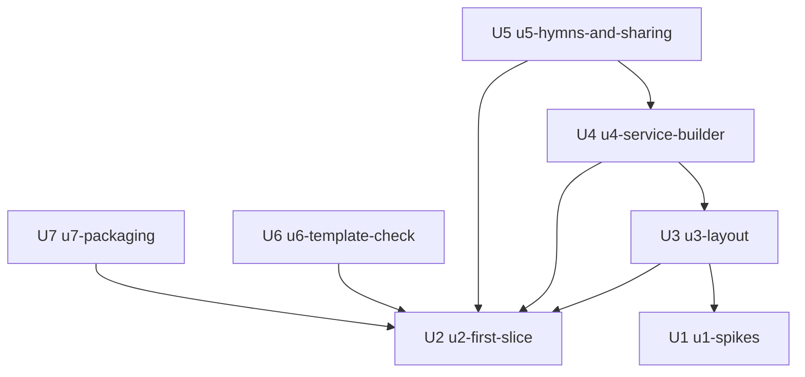

# Unit Dependencies: AutoPPT Rewrite

This file describes topology only: what can depend on what. It does not pick a build order or a critical path. Delivery Planning does that.

## Dependency Graph

A Unit depends on every Unit whose code, tests or recorded results it needs. Arrows read "depends on".



## Edge Block

```yaml
units:
  - name: u2-first-slice
    kind: ui
    depends_on: []
  - name: u1-spikes
    kind: spec
    depends_on: []
  - name: u3-layout
    kind: library
    depends_on: [u1-spikes, u2-first-slice]
  - name: u6-template-check
    kind: library
    depends_on: [u2-first-slice]
  - name: u4-service-builder
    kind: ui
    depends_on: [u2-first-slice, u3-layout]
  - name: u5-hymns-and-sharing
    kind: ui
    depends_on: [u2-first-slice, u4-service-builder]
  - name: u7-packaging
    kind: packaging
    depends_on: [u2-first-slice]
```

The units in the edge block above are listed in the order Delivery Planning chose (U2, U1, U3, U6, U4, U5, U7), so that the engine, which takes the first unit it can build, builds U2 first. The order changes no edge. Delivery Planning Q2 and Q3 are the reason.

## Why each edge exists

| Unit | Depends on | Reason |
|---|---|---|
| u2-first-slice | none | The runnable thin slice is a root and the first runnable Unit. It does not wait for the spikes: S3 (sign-in) has a documented fallback, so U2 builds the primary sign-in and switches to the fallback if S3 fails. Delivery Planning may still schedule the spikes first. |
| u3-layout | u1-spikes, u2-first-slice | Needs the font and padding results of S1 (and the indent method of S2) from U1 for the paginator, and completes the thin `Paginator` and `PassageLayout` that U2 starts. |
| u4-service-builder | u2-first-slice, u3-layout | Completes the thin `MakeSlidesRun` of U2, adds screens to `ScreenViews`, and its Make slides run calls every layout of U3. |
| u5-hymns-and-sharing | u2-first-slice, u4-service-builder | Adds steps to `LibrarySync` (U2), adds the hymn editor to `SlideEditors` and the Reload button to Settings (U4), and `ReloadAllHymns` calls `ServiceBuilder` (U4). |
| u6-template-check | u2-first-slice | Reads the template with `TemplateReader` and the slide types and fonts from `Configuration`, both in U2. |
| u7-packaging | u2-first-slice | Adds the update screen to `ScreenViews` and wires `ReleaseChecker` into `Startup`, both in U2. |

## Integration Points

- **Ports owned by `core`** (components.md, Ports): U2 defines the ports for Google, ESV, the library and the connectivity probe. Every later Unit adds implementations or users of these ports without changing their shape. A change to a port is a change to U2, so every Unit that depends on it must be rechecked.
- **`SlidePlan`**: produced by the layouts of U3 and read by `SlideWriter` of U2. U2 fixes its shape for one passage row, and U3 extends it for hymns and text. The shape is settled in Contract Design.
- **Shared data**: `secrets.json` and the settings file (U2, extended by U4), the service file (U4), and the library cache (U2, with the Reload swap in U5). Each has one writer: `SecretStore`, `UserSettings`, `ServiceStore` and `LibrarySync`.
- **Events**: `ConnectionMonitor` lost and restored events (U2) are used by `ScreenViews` in every Unit that adds a screen.

## Component edges that point to a later Unit

Some calls in `components.md` run from a component built in an earlier Unit to a component that a later Unit owns. None of them is a Unit edge, because each goes through a port owned by `core` or through a screen or editor that the later Unit adds itself. The earlier Unit builds and tests against a fake of the port.

| Call in components.md | Calling Unit | Owning Unit | How it is satisfied |
|---|---|---|---|
| `Startup` to `ReleaseChecker` | U2 | U7 | Through `ReleaseCheckerPort`. U2 runs start-up against a fake `ReleaseCheckerPort` that reports no newer version. U7 adds the real `ReleaseChecker` and the update screen. |
| `ScreenViews` to `ServiceBuilder`, `ErrorModel`, `MakeSlidesRun` | U2 | U4 | Not called in U2. U2 builds only the start-up screens and the wizard, which use `Startup`, `SetupService`, `GoogleAuth`, `UserSettings` and `ConnectionMonitor`. U4 adds the main window, the progress dialog and the error dialog to `ScreenViews`, and these calls appear then. |
| `ScreenViews` to `SlideEditors` | U2 | U4 | Same: U4 adds the editors and the screens that host them. |
| `ScreenViews` to `ReloadAllHymns` | U2 | U5 | U5 adds the Reload all hymns button and its confirmations to the Settings screen it extends, and the call appears then. |
| `SlideEditors` to `HymnStore` | U4 | U5 | U5 adds the hymn editor to `SlideEditors`, so the call exists only in U5's code. U4 builds the other editor kinds, which do not call `HymnStore`. |
| `MakeSlidesRun` (thin, in U2) to the layouts, `SlidesCleaner` and `ErrorModel` | U2 | U3, U4 | U2's thin run writes one passage row through its own thin `PassageLayout`. U4 completes the run and adds the calls to the full layouts (U3), `SlidesCleaner` and `ErrorModel`. |
| `ServiceBuilder` to `ReloadAllHymns` (clearing local edits) | U4 | U5 | The call is from `ReloadAllHymns` (U5) to `ServiceBuilder` (U4), which is a normal edge from U5 to U4. `ServiceBuilder` only offers the clearing step. |

## Parallel Development Opportunities

Units with no edge between them, and no chain of edges, may be built at the same time, each in its own copy of the project. The valid sets are:

- U1 and U2 are both roots, so they may be built at the same time. U1 is a spec Unit with no app code.
- After U2: U6 and U7 may be built at once, and with U1 and U2 done, U3 too. U3, U6 and U7 have no edge between them.
- U6 and U7 have no edge to U4 or U5 either.
- U5 has no direct edge to U3, but it depends on U4, which depends on U3, so it follows U3 in every valid order.
- Only U3 waits for U1, so S1 and S2 must be recorded before the paginator is built. U2, U6 and U7 do not wait for any spike.

Several orderings are valid. Delivery Planning chooses one.

## First slice and the walking skeleton

U2 is a root of the graph and is the first Unit that runs end to end, as Q3 chose. The team's walking skeleton is this slice (team.md). U1 is also a root, but it is a `spec` Unit with no app code and cannot run, so it is not the slice. The owner removed the edge from U2 to U1 so that the runnable slice is the first runnable Unit. Delivery Planning may still schedule the spikes before the slice.

## Sources

- [Q2] to [Q8] units-generation-questions.md.
- [Q6] Only real code dependencies are drawn.

## Assumptions & Open Questions

- [assumption] U4 depends on U3 because its Make slides run plans every row type through the layouts. If Delivery Planning builds a U4 version that only makes passage slides first, that is a decision about order, not about the edge.
- [assumption] U7 depends only on U2 by code. The release is useful only after the other Units are done, which is an order decision for Delivery Planning, not an edge.
- [assumption] U2 does not depend on U1. If S3 fails, U2's sign-in is changed to the documented fallback (the restricted `drive` scope is replaced by `drive.file` with the Google Picker), and that change belongs to U2. This is rework risk, accepted by the owner.

The graph has 7 Units and 8 edges, and no cycle.
